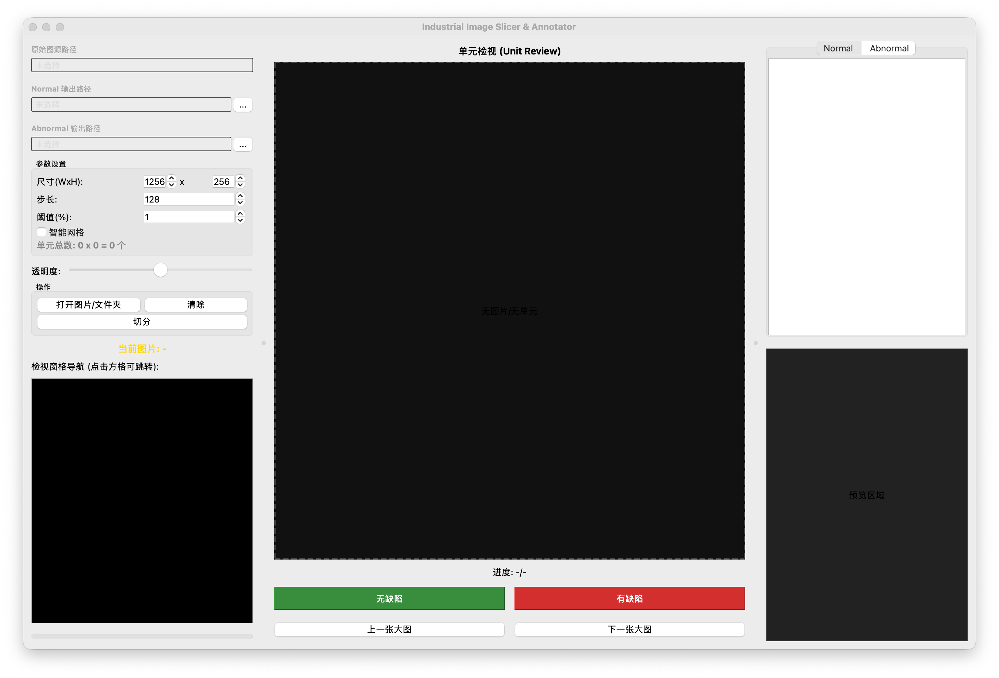

# AnomaSlice — Windows 图片标注与切图

原生 Qt 桌面应用，提供两个可切换的模式：**框选标注**与**切图分类**。
无需浏览器、服务器、账号或模型下载；所有标注在本机保存。

## Windows 便携版

[下载最新 Windows 便携版](https://github.com/get1024/AnomaSlice/releases/latest/download/AnomaSlice-Windows-x64.zip)，
或到 [Releases 页面](https://github.com/get1024/AnomaSlice/releases/latest)查看版本说明。

解压 `AnomaSlice-Windows-x64.zip`，双击其中的 `AnomaSlice/AnomaSlice.exe`。
目标电脑无需安装 Python。请保持 EXE 与 `_internal` 文件夹放在一起。
分享给别人时请发送完整 ZIP 或整个解压目录，不要只发送 EXE。

从源码构建（Windows、64 位 Python 3.12）：

```powershell
.\build-windows.ps1 -Python C:\path\to\python.exe -InstallDependencies
```

使用已有 AnomaSlice 环境可直接执行 `.\build-windows.ps1`。
构建采用目录分发以减少启动解压等待，排除 Qt Web/QML、多媒体与视频解码组件。

## 框选标注（默认模式）

1. 点击“打开图片”，选择文件；之后可用“上一张 / 下一张”浏览同文件夹图片。
2. **滚轮**缩放，**右键按住拖动**平移，点击“适应窗口”恢复完整视图。
3. **左键按住拖动**画矩形框，松开后输入框出现在框的左上方。
4. 输入标签或别名，按 **Enter** 确认；**Esc** 取消当前未确认的框。
5. **单击**已有框将其选中，**Delete** 删除；**双击**已有框修改标签。
6. **Ctrl+Z** 撤回，**Ctrl+Shift+Z** 重做；输入框有焦点时撤回的是文字编辑。

“缺陷种类与别名”中每行填写一个类别，多个别名用逗号分隔。
例如类别“划痕”的别名为 `1, scratch`，输入 `1` 会保存为“划痕”，
输入 `待定1` 保持原样。匹配针对完整文本且区分大小写，不进行子串替换。
可直接输入新类别；重复别名、与类别名称冲突的别名会提示修正。
编辑类别表只影响后续输入，已有框的标签文字会保留。

每次确认、删除、改标签或撤回后自动保存。`Ctrl+S` 可重试保存。
标注保存为图片旁的 `<原图片完整文件名>.annotations.json`，不修改图片本身。
坐标是**原图像素坐标** `[x, y, width, height]`，右边界和下边界不包含在框内，
缩放、平移不改变坐标。文件包含图片名称、尺寸、类别表和框列表：

```json
{
  "version": 1,
  "image": "sample.png",
  "width": 1920,
  "height": 1080,
  "boxes": [{"label": "划痕", "bbox": [100, 80, 60, 40]}],
  "label_catalog": [{"name": "划痕", "aliases": ["1"]}]
}
```

切换图片会取消尚未确认的框；已经确认的框会自动恢复。
保存失败时保留当前图片与编辑内容；读取到损坏或尺寸不匹配的标注文件时停止编辑该图，保留原文件。
当前支持矩形框和文字类别；调整框的尺寸可撤回或删除后重新画框。

## 切图分类模式（原有功能）

顶部切换到“切图分类”后使用下述原有流程。
框选标注与切图掩膜独立保存，框选标签不会自动改写 Normal/Abnormal 分类。

工业视觉图像切分标注工具是一个基于 Python 的桌面 GUI 应用，主要用于工业质检（AOI）场景下的数据集制作。它通过网格化切分和交互式标注，帮助用户高效地将高分辨率工业图像切分为小图，并自动分类为 Normal（正常）和 Abnormal（缺陷）。

> **目标**：在尽量减少人工逐张分类工作的前提下，高效构建高质量的工业缺陷检测 / 分割数据集。

## 🖼️ UI 界面



## 🎥 使用演示 (Demo)


## ✨ 功能特性

### 1. 图像切分 (Image Slicing)
- **自定义尺寸**：支持将大图切分为固定尺寸的小图（可配置宽、高，如 256x256）。
- **步长控制 (Stride)**：支持设置步长，控制小图之间的重叠程度（Overlap）。
- **网格预览**：切分网格以叠加层的形式实时显示在原图上，方便预判切分效果。
- **智能网格**：支持双色虚线网格，适应不同背景亮度的图片。

### 2. 网格化标注与审查 (Grid Annotation & Review)
- **单元检视 (Unit Review)**：提供专门的“单元检视”模式，自动遍历每一个切分单元（Patch）。
- **快速分类**：用户只需对当前高亮显示的 Patch 点击“有缺陷”或“无缺陷”按钮（或使用快捷键），即可完成标注。
- **状态可视化**：已标注为“缺陷”的区域会在原图上以红色半透明矩形覆盖，直观展示缺陷分布。

### 3. 自动归类与保存 (Auto Classification)
- **后台切分**：点击“执行切分”后，后台线程自动根据用户的标注结果，将小图分别保存至 `Normal` 和 `Abnormal` 目录。
- **中文路径支持**：完整支持中文文件路径的读取和保存。

### 4. 工程管理 (Project Management)
- **进度保存**：支持将当前进度、配置参数、标注数据持久化保存为 JSON 工程文件 (`.json`)。
- **防止丢失**：避免因程序意外关闭或中断导致的工作丢失。

### 5. 结果预览 (Gallery)
- **实时查看**：切分完成后，右侧预览区会自动加载 Normal / Abnormal 文件夹中的图片。
- **懒加载**：支持缩略图懒加载，避免大量图片导致的内存溢出和界面卡顿。

## 🛠 技术栈

- **语言**：Python 3.12
- **GUI 框架**：PySide6 (Qt for Python)
- **图像处理**：OpenCV (cv2), NumPy
- **图像显示**：Qt (QImage / QPixmap)
- **配置管理**：JSON

## 🚀 快速开始

### 1. 准备运行环境

建议使用 Conda 创建独立环境：

```bash
conda create -n AnomaSlice python=3.12
conda activate AnomaSlice
```

安装依赖：

```bash
pip install -r requirements-runtime.txt
```

### 2. 运行程序

在项目根目录下执行：

```bash
python main.py
```

或者直接运行 `dist` 目录下的可执行文件（如果有）：

```bash
./dist/AnomaSlice/AnomaSlice.exe
```

## 📖 基本使用流程

1. **新建/打开工程**：
   - 启动程序，点击“文件” -> “新建工程”或“打开工程”。
   - 设置**原始图片路径**、**Normal 输出路径**、**Abnormal 输出路径**。

2. **调整切分参数**：
   - 在左侧面板设置 **Patch Size** (宽/高) 和 **Stride** (步长)。
   - 观察原图上的网格预览，确保切分大小合适。

3. **标注与审查**：
   - 程序会自动进入“单元检视”模式，高亮显示第一个 Patch。
   - 观察中间下方的“单元检视”窗口，判断当前 Patch 是否有缺陷。
   - 点击 **“有缺陷”** (红色) 或 **“无缺陷”** (绿色) 按钮。
   - 程序会自动跳转到下一个 Patch，直至完成整张图的标注。
   - *提示：也可以直接在原图画布上点击某个网格来进行跳转或修改状态。*

4. **执行切分**：
   - 标注完成后，点击 **“Slice and Next”** (或按 Enter 键)。
   - 程序会在后台将切分好的图片保存到对应文件夹。
   - 保存完成后，自动清空画布并加载下一张原始图片（如果有）。

5. **结果检查**：
   - 右侧预览区会刷新显示刚刚切分出的图片，可双击查看大图。

## ⌨️ 快捷键

- `Ctrl + Z` / `Ctrl + Shift + Z`：撤销 / 重做
- `Ctrl + S`：保存工程
- `Ctrl + O`：打开工程
- `Enter` (Return)：执行切分并进入下一张图片 (Slice and Next)
- `Wheel` (滚轮)：缩放视图，无需按 Ctrl

## 📂 项目结构

```
AnomaSlice/
├── main.py             # 程序入口与核心逻辑
├── dist/
│   └── AnomaSlice/AnomaSlice.exe  # 便携版入口，需保留旁边的 _internal
├── README.md            # 项目说明文档
├── demo.mp4             # 使用演示视频
└── ...
```

## ⚠️ 注意事项

- **路径设置**：请确保输出目录（Normal/Abnormal）具有写入权限。
- **大图性能**：对于超大分辨率（如 10000x10000+）的图片，建议适当增大 Stride 以减少 Patch 数量，避免内存占用过高。

## 开发验证

```powershell
$env:QT_QPA_PLATFORM = 'offscreen'
python -m unittest discover -s tests -v
python main.py --smoke-test
```

测试覆盖别名精确匹配、原图坐标、缩放/平移、画框/重命名/撤回、自动保存与重开、
写入失败与损坏文件保护、旧工程加载和原有切图输出。
